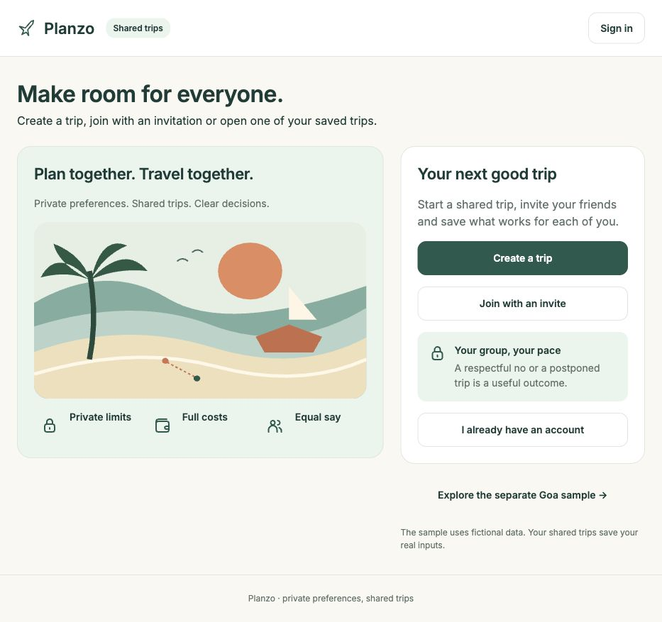
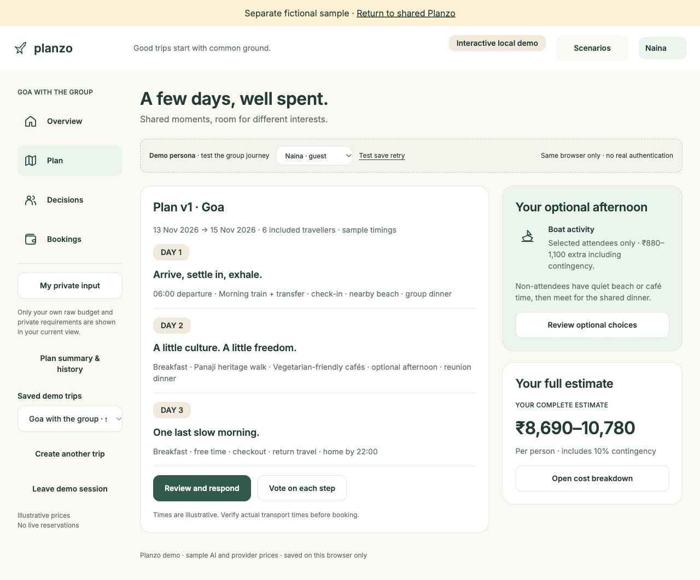
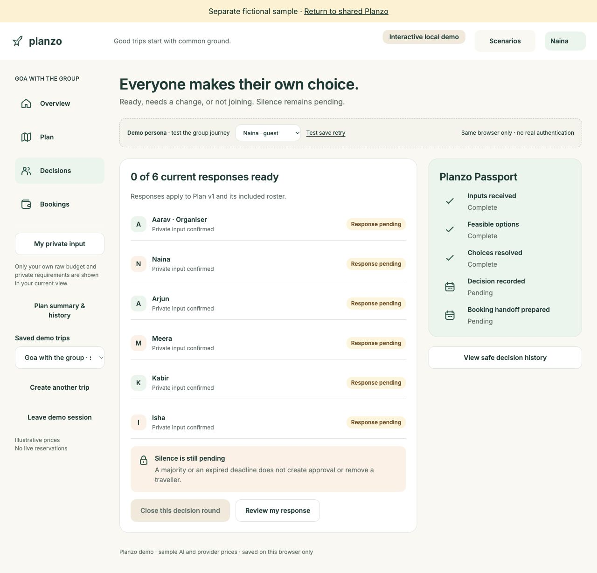

# Planzo

**Plan trips together without making everyone share their private limits.** Planzo is a collaborative travel-planning web app. An organiser creates a trip and invites friends; each person adds their own availability, budget and preferences. The group can review a shared itinerary, resolve decisions, and explicitly respond to the current version before treating the plan as agreed.

[Open the live app](https://person-siren-40913121.figma.site/) · [Explore the fictional Goa sample](https://person-siren-40913121.figma.site/?demo=1) · [View the Figma design](https://www.figma.com/design/IRAXhHV3ldeGoxWwXJeZk9/Planzo-Design?node-id=22-266)

## App screenshots

The itinerary and decision views use the separate fictional Goa sample. Click an image to see it at full size.

### Live app landing page

[](docs/landing.jpg)

### Fictional Goa sample

| Trip itinerary and personal estimate | Group decision status |
| --- | --- |
| [](docs/itinerary.jpg) | [](docs/decisions.jpg) |

## The problem

Group trips often stall because dates, costs and personal needs are scattered across messages. A popular option can still be unaffordable or impossible for someone. Planzo makes those constraints visible in the decision process while keeping each person's raw budget and private reasons out of shared summaries.

## What the app covers

- **Shared trip setup:** organiser accounts, trip creation, invitation links, member joining and saved trip workspaces.
- **Private input:** individual availability, budget and preferences feed planning without displaying raw private briefs to the group.
- **Planning and review:** itinerary proposals, estimated costs, feasibility checks, human review and item-level decisions.
- **Explicit agreement:** members respond to a specific plan version; material changes require fresh responses. Silence remains pending.
- **Final journey:** a readable itinerary and booking guidance. Booking status is self-reported and does not create or verify a reservation.

The default experience uses Supabase Auth, a trip-scoped database and Edge Functions. A separate `?demo=1` experience uses fictional Goa data stored in the browser, so visitors can explore the product without creating an account.

## Explore it

1. Open the [fictional Goa sample](https://person-siren-40913121.figma.site/?demo=1) and choose **Explore the Goa sample**.
2. Review a member's cost and availability, then inspect the group's decisions and current plan.
3. Use **Scenarios** to see how changes in price, dates, headcount or responses affect agreement.

The sample is local to your browser. For the shared experience, start at the [live app](https://person-siren-40913121.figma.site/); account creation and email verification are part of that flow.

## Technology and project structure

| Area | Implementation |
| --- | --- |
| Interface | React 19, TypeScript, Vite 8, Tailwind CSS 4, Figma-derived assets |
| Shared data | Supabase Auth, PostgreSQL, row-level access controls and Edge Functions |
| Assisted planning | Gemini-backed proposals with consent, validation and human review |
| Sample | Separate browser-saved demo with fictional data |
| Verification | Type checks, unit tests, build checks and documented hosted checks |

- `src/main.tsx` selects the shared app or separate sample.
- `src/LiveApp.tsx` and related `src/Live*.tsx` files contain the shared journeys; `src/App.tsx` contains the sample.
- `src/domain.ts`, `src/routePlanning.ts` and `src/routeCompiler.ts` hold planning rules and route checks.
- `supabase/migrations/` and `supabase/functions/` contain the backend source.
- `tests/` contains application tests; `docs/` contains implementation and verification notes.

## Run locally

Use Node.js 22 and pnpm 10 (versions are recorded in `.mise.toml`).

```sh
pnpm install --frozen-lockfile
pnpm run dev
```

Vite uses port 8443 by default. Open `http://localhost:8443/?demo=1` for the self-contained fictional sample. The default shared route points to the existing Supabase project and requires working authentication and redirect configuration; it is not a fresh backend setup guide.

```sh
pnpm run typecheck
pnpm test
pnpm run build
```

## Current status

Planzo is a live, evolving prototype. The shared planning flow and the separate sample are available, but the newest **complete-route AI generation is not yet reliable across live requests**. The [latest route-planning handoff](docs/ROUTE_PLANNING_HANDOFF.md) records that limitation and its verification evidence. Generated prices, schedules and locations are estimates to review, not live travel quotes. Travel-provider booking, payment and reservation confirmation are outside the app.

For implementation history and test detail, see the [handoff documents](docs/) and [test report](docs/TEST_REPORT.md).
